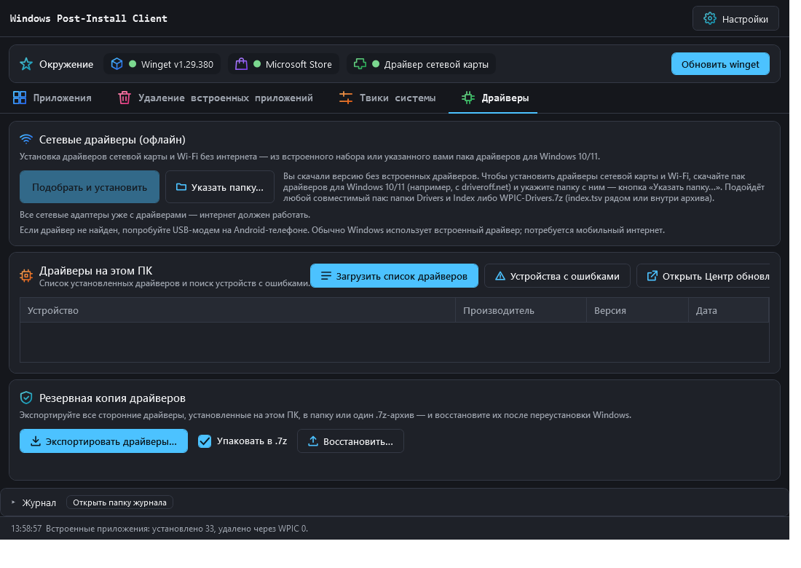

<div align="center">


# Windows Post-Install Client (WPIC)

**One tool to bring a freshly installed Windows 10/11 back to life — even with no network at all.**

[](https://github.com/denvisss/WPIC/releases/latest)
[](https://github.com/denvisss/WPIC/releases)
[](#-building-from-source)
[](#-requirements)
[](#-verification)
[](#)

**English** · [Русский](#-русский)

</div>

---

## 📖 About

WPIC prepares a freshly installed Windows 10/11 (x64) for real use: it brings the network up, installs the software you select and tunes the system — every step offline-capable, logged and reversible.

- 🖧 **Offline drivers** — detects NIC/Wi-Fi adapters without a driver, matches hardware IDs against a curated pack, installs the newest matching version via `pnputil`.
- 📦 **Offline winget** — signed `AppInstaller` / `VCLibs` / `UI.Xaml` packages are embedded in the executable; winget bootstraps without internet.
- 🗂 **App catalog** — 49 apps in 7 sections, RU/EN descriptions, version badges refreshed from winget at startup; multi-select, one install button.
- 🛠 **38 system tweaks** — five collapsible icon categories, per-category *Select all*, risk dots, automatic registry snapshot, one-click undo.
- 🧹 **Built-in app removal** — curated UWP catalog with real icons, install dates and per-app removal risk; verified removal, optional provisioned cleanup, restore from the Windows image.
- ⬆️ **Self-update** — GitHub releases are checked at startup; the update installs in place from Settings.
- 🌐 **Bilingual UI** (EN/RU), dark/light themes, full activity log on screen and on disk.

## 🖼 Screenshots

| App catalog | Built-in app removal |
|---|---|
|  |  |

| Drivers tab | System tweaks |
|---|---|
|  |  |

## 📥 Releases

Download from [GitHub Releases](https://github.com/denvisss/WPIC/releases/latest). Every artifact has a `.sha256` sidecar — verify with `Get-FileHash` or `sha256sum`.

| Artifact | Size | Contents |
|---|---|---|
| `WPIC_1.1.0-full.exe` | ≈ 368 MiB | Inno Setup installer: app + embedded LAN/Wi-Fi driver pack + offline winget |
| `WPIC_1.1.0-full.zip` | ≈ 368 MiB | The same installer in a zip |
| `WPIC_1.1.0-portable.exe` | ≈ 134 MiB | Single-file portable app: embedded winget, no bundled drivers |
| `WPIC_1.1.0-portable.zip` | ≈ 127 MiB | The same portable exe in a zip |

**Full** — for a clean machine without network: install, open the *Drivers* tab, press one button. **Portable** — for a USB toolkit: pair it with any compatible driver pack. Both require Windows 10 (1809+) / 11 x64 and administrator rights; the .NET runtime is embedded; internet is needed only for app installation from winget.

## 🖧 Driver packs

The *Drivers* tab finds adapterless NIC/Wi-Fi devices automatically and offers *Match & install*. Any compatible pack works:

- **WPIC format** — a folder with `WPIC-Drivers.7z` (hardware-ID index is read from inside the archive, or from `index.tsv` next to it);
- **External pack** — a folder with `Drivers\*.7z` and `Index\DIA\*.txt`; WPIC builds the index itself and keeps only the newest version per device.

A pack folder (or any file inside it) can be **drag & drop**ped onto the window. Packs are auto-searched next to the exe, in every local drive root and on removable media.

## ⚙️ Customization (no rebuild needed)

`configs/apps.json` and `configs/tweaks.json` sit next to the exe; an embedded copy is used when the file is absent (portable).

```json
{
  "id": "steam",
  "name": "Steam",
  "wingetId": "Valve.Steam",
  "wingetIds": ["Optional.MultiPackage"],
  "windowsFeature": "NetFx3"
}
```

Tweak actions: `registry` (original value and its real type are saved automatically), `systemParameter` (`animations`, `stickyKeysHotkey`, `filterKeysHotkey`) and `command` (cmd command with `undoCommand`). `minBuild`/`maxBuild` and `editions` limit applicability.

## 🔨 Building from source

Requires .NET 8 SDK, Windows and Inno Setup 6.3+. The winget payload is embedded at compile time — fetch it once before the first build or `dotnet test`:

```powershell
.\build\fetch-winget.ps1
dotnet test tests\WPIC.Tests\WPIC.Tests.csproj
.\build\build-release.ps1
```

`build-release.ps1` verifies Microsoft signatures, runs Release tests and produces all four artifacts with `.sha256` in `build\release\`. CI fetches the payload and runs the tests on Windows for every push and PR.

## 📁 Data locations

| Data | Path |
|---|---|
| Logs | `%LOCALAPPDATA%\WPIC\logs\` |
| Registry backups / tweak originals | `%LOCALAPPDATA%\WPIC\backup\`, `tweak-originals.json` |
| Driver extraction cache, bundled 7-Zip | `%LOCALAPPDATA%\WPIC\driver-cache\`, `tools\` |
| Unpacked winget payload (portable) | `%LOCALAPPDATA%\WPIC\winget\` |
| Catalog version cache | `%LOCALAPPDATA%\WPIC\catalog-versions.json` |
| Removed built-in apps journal | `%LOCALAPPDATA%\WPIC\bloat-removed.json` |

## ✅ Verification

158 xUnit tests (catalog contract, winget parsing, tweak engine, driver index, localization) plus offscreen WPF harnesses that drive the real views: catalog rendering and batch install, tweak expanders/select-all/apply/undo on an isolated registry key, winget banner states, pack drag & drop and index-in-archive loading.

## 📜 License

The code is licensed under the [MIT License](LICENSE) — copying is permitted with attribution. Bundled components: `7za64.exe` (7-Zip, LGPL), unmodified signed Microsoft packages (winget payloads). Third-party driver licensing remains the user's responsibility.

---

<div align="center">

## 🇷🇺 Русский

[English](#windows-post-install-client-wpic) · **Русский**

</div>

## 📖 О программе

WPIC готовит чистую Windows 10/11 (x64) к работе: поднимает сеть, устанавливает выбранные приложения и настраивает систему — каждый шаг работает офлайн, пишется в журнал и откатывается.

- 🖧 **Офлайн-драйверы** — находит NIC/Wi-Fi без драйвера, подбирает по ID оборудования из курируемого пака, ставит новейшую подходящую версию через `pnputil`.
- 📦 **Офлайн-winget** — подписанные `AppInstaller` / `VCLibs` / `UI.Xaml` встроены в exe; winget поднимается без интернета.
- 🗂 **Каталог приложений** — 49 приложений в 7 разделах, описания RU/EN, бейджи версий из winget при запуске; мультивыбор, одна кнопка установки.
- 🛠 **38 твиков** — пять раскрываемых категорий с иконками, «выбрать все» по категории, точки риска, снимок реестра до применения, откат одной кнопкой.
- 🧹 **Удаление встроенных приложений** — курируемый каталог UWP с настоящими иконками, датами установки и риском удаления; проверенное удаление, опциональная чистка provisioned, восстановление из образа Windows.
- ⬆️ **Самообновление** — проверка релизов GitHub при запуске, установка поверх из настроек.
- 🌐 **Интерфейс** EN/RU, тёмная и светлая темы, полный журнал операций.

## 🖼 Скриншоты

| Каталог приложений | Удаление встроенных приложений |
|---|---|
|  |  |

| Вкладка «Драйверы» | Твики системы |
|---|---|
|  |  |

## 📥 Релизы

Скачивание: [GitHub Releases](https://github.com/denvisss/WPIC/releases/latest). У каждого артефакта есть `.sha256` — проверка через `Get-FileHash` или `sha256sum`.

| Артефакт | Размер | Содержимое |
|---|---|---|
| `WPIC_1.1.0-full.exe` | ≈ 368 МиБ | Установщик Inno Setup: приложение + встроенный пак драйверов LAN/Wi-Fi + офлайн-winget |
| `WPIC_1.1.0-full.zip` | ≈ 368 МиБ | Тот же установщик в zip |
| `WPIC_1.1.0-portable.exe` | ≈ 134 МиБ | Портативный exe: встроенный winget, без встроенных драйверов |
| `WPIC_1.1.0-portable.zip` | ≈ 127 МиБ | Тот же portable exe в zip |

**Full** — для чистой машины без сети: установил, открыл «Драйверы», одна кнопка. **Portable** — для флешки: носите вместе с любым совместимым паком драйверов. Обе версии: Windows 10 (1809+) / 11 x64, права администратора, .NET встроен; интернет нужен только для установки приложений через winget.

## 🖧 Паки драйверов

Вкладка «Драйверы» сама находит устройства без драйвера и предлагает «Подобрать и установить». Подойдёт любой совместимый пак:

- **формат WPIC** — папка с `WPIC-Drivers.7z` (индекс читается из архива или из `index.tsv` рядом);
- **внешний пак** — папка с `Drivers\*.7z` и `Index\DIA\*.txt`; индекс строится автоматически, остаются только новейшие версии на устройство.

Папку пака (или любой файл внутри неё) можно **перетащить** на окно. Автопоиск: рядом с exe, в корне локальных дисков и на съёмных носителях.

## ⚙️ Настройка без пересборки

`configs/apps.json` и `configs/tweaks.json` лежат рядом с exe; при отсутствии файла используется встроенная копия (portable).

```json
{
  "id": "steam",
  "name": "Steam",
  "wingetId": "Valve.Steam",
  "wingetIds": ["Optional.MultiPackage"],
  "windowsFeature": "NetFx3"
}
```

Действия твиков: `registry` (исходное значение и тип сохраняются автоматически), `systemParameter` (`animations`, `stickyKeysHotkey`, `filterKeysHotkey`), `command` (команда cmd с `undoCommand`). `minBuild`/`maxBuild` и `editions` ограничивают применимость.

## 🔨 Сборка

Нужны .NET 8 SDK, Windows и Inno Setup 6.3+. Winget-пак встраивается при компиляции — скачайте его один раз до первой сборки или `dotnet test`:

```powershell
.\build\fetch-winget.ps1
dotnet test tests\WPIC.Tests\WPIC.Tests.csproj
.\build\build-release.ps1
```

`build-release.ps1` проверяет подписи Microsoft, прогоняет Release-тесты и создаёт четыре артефакта с `.sha256` в `build\release\`. CI скачивает пак и гоняет тесты на Windows для каждого push и PR.

## 📁 Данные приложения

| Данные | Путь |
|---|---|
| Журналы | `%LOCALAPPDATA%\WPIC\logs\` |
| Копии реестра / исходные значения твиков | `%LOCALAPPDATA%\WPIC\backup\`, `tweak-originals.json` |
| Кэш драйверов, встроенный 7-Zip | `%LOCALAPPDATA%\WPIC\driver-cache\`, `tools\` |
| Распакованный winget-пак (portable) | `%LOCALAPPDATA%\WPIC\winget\` |
| Кэш версий каталога | `%LOCALAPPDATA%\WPIC\catalog-versions.json` |
| Журнал удалённых встроенных приложений | `%LOCALAPPDATA%\WPIC\bloat-removed.json` |

## ✅ Проверка

158 тестов xUnit (контракт каталога, парсинг winget, движок твиков, индекс драйверов, локализация) плюс офскрин-харнесы на реальных вкладках: каталог и пакетная установка, категории-раскрывашки твиков, «выбрать все», применение/откат на изолированном ключе реестра, баннер winget, drag & drop пака и чтение индекса из архива.

## 📜 Лицензия

Код — под лицензией [MIT](LICENSE) — копирование разрешено с указанием авторства. В составе распространяются `7za64.exe` (7-Zip, LGPL) и неизменённые подписанные пакеты Microsoft (winget). Ответственность за лицензии сторонних драйверов — на пользователе.
