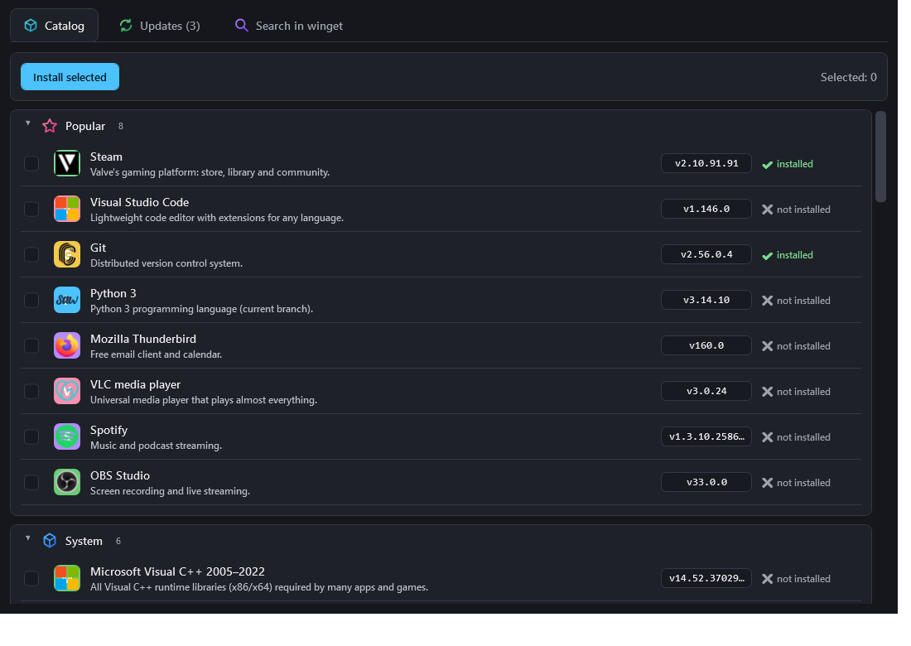
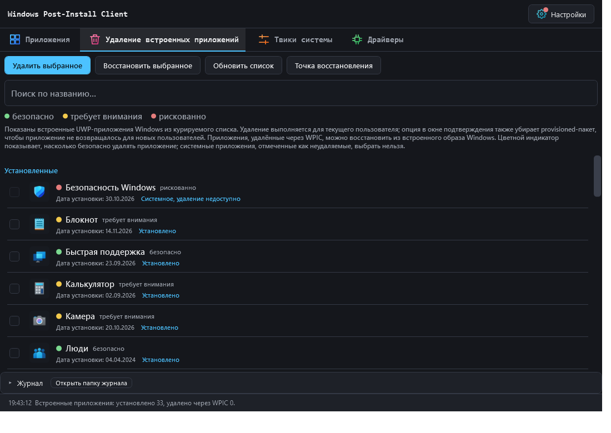

<div align="center">


# Windows Post-Install Client (WPIC)

**One tool to bring a freshly installed Windows 10/11 back to life — even with no network at all.**

[](https://github.com/denvisss/WPIC/releases/latest)
[](https://github.com/denvisss/WPIC/releases)
[](#-building-from-source)
[](#-requirements)
[](#-verification)
[](#)

**English** · [Русский](#-русский)

</div>

---

## 📖 About

WPIC prepares a freshly installed Windows 10/11 (x64) for real use: it brings the network up, installs the software you select and tunes the system — every step offline-capable, logged and reversible.

- 🖧 **Offline drivers** — detects NIC/Wi-Fi adapters without a driver, matches hardware IDs against a curated pack, installs the newest matching version via `pnputil`; third-party drivers can be **exported** to a folder (optionally packed into a single 7z) and **restored** after reinstalling Windows — the export shows a live progress bar with the percentage and estimated time remaining.
- 🧭 **Environment panel** — a bar above the tabs shows the state of winget, Microsoft Store and the NIC driver, each with its own button: install winget with or without the Store (payload is downloaded from official Microsoft sources and verified by SHA-256), restore the Store, update winget, or match a NIC driver from a pack.
- 🗂 **App catalog & winget search** — the *Installing apps* tab opens a curated catalog of 49 popular apps in 7 sections with real app icons, version chips and colored install status; *Popular* is pinned at the top and every section collapses with a click. That is only a starting point: the built-in search installs **any** package from the entire winget repository. Versions and install statuses refresh from winget at startup; multi-select, one install button.
- 🛠 **65 system tweaks** — six collapsible icon categories, collapsed by default, per-category *Select all*, risk dots, automatic registry snapshot, one-click undo.
- 🧹 **Built-in app removal** — curated UWP catalog with real icons, install dates and per-app removal risk; verified removal, optional provisioned cleanup, restore from the Windows image.
- ⬆️ **Self-update** — GitHub releases are checked at startup; the update installs in place from Settings.
- 🌐 **Bilingual UI** (EN/RU), dark/light themes, full activity log on screen and on disk.

## 🖼 Screenshots

| App catalog | Built-in app removal |
|---|---|
|  |  |

| Drivers tab | System tweaks |
|---|---|
|  |  |

## 📥 Releases

Download from [GitHub Releases](https://github.com/denvisss/WPIC/releases/latest). Every artifact has a `.sha256` sidecar — verify with `Get-FileHash` or `sha256sum`.

| Artifact | Size | Contents |
|---|---|---|
| `WPIC_1.2.0-full.exe` (also `.zip`) | 302.0 MiB | Inno Setup installer: app + embedded LAN/Wi-Fi driver pack — for a clean machine without network: install, open *Drivers*, press one button |
| `WPIC_1.2.0-lite.exe` (also `.zip`) | 59.0 MiB | The same installer without the driver pack |
| `WPIC_1.2.0-portable.exe` (also `.zip`) | 64.0 MiB | Single-file app, no installer — a USB toolkit, pair it with any compatible driver pack |

Windows 10 (1809+) / 11 x64, administrator rights; the .NET runtime is embedded, internet is needed only for app installation from winget.

## 🖧 Driver packs

The *Drivers* tab finds adapterless NIC/Wi-Fi devices automatically and offers *Match & install*. Any compatible pack works:

- **WPIC format** — a folder with `WPIC-Drivers.7z` (hardware-ID index is read from inside the archive, or from `index.tsv` next to it);
- **External pack** — a folder with `Drivers\*.7z` and `Index\DIA\*.txt`; WPIC builds the index itself and keeps only the newest version per device.

A pack folder (or any file inside it) can be **drag & drop**ped onto the window. Packs are auto-searched next to the exe, in every local drive root and on removable media.

## ⚙️ Customization (no rebuild needed)

`configs/apps.json` and `configs/tweaks.json` sit next to the exe; an embedded copy is used when the file is absent (portable).

```json
{
  "id": "steam",
  "name": "Steam",
  "wingetId": "Valve.Steam",
  "wingetIds": ["Optional.MultiPackage"],
  "windowsFeature": "NetFx3"
}
```

Tweak actions: `registry` (original value and its real type are saved automatically), `systemParameter` (`animations`, `stickyKeysHotkey`, `filterKeysHotkey`) and `command` (cmd command with `undoCommand`). `minBuild`/`maxBuild` and `editions` limit applicability.

## 🔨 Building from source

Requires .NET 8 SDK, Windows and Inno Setup 6.3+ (installers only). The full installer additionally needs the curated driver pack in `build\payload\DriverPack\` — `run-curate.ps1` rebuilds it from source lists; tests and the portable/lite builds work without it.

```powershell
dotnet test tests\WPIC.Tests\WPIC.Tests.csproj
.\build\build-release.ps1
```

`build-release.ps1` runs Release tests, publishes the app and produces six artifacts — `full` / `lite` / `portable` exe plus a zip of each, all with `.sha256` sidecars — in `build\release\`. The lite installer ships without the driver pack. CI runs the tests on Windows for every push and PR.

## 📁 Data locations

| Data | Path |
|---|---|
| Logs | `%LOCALAPPDATA%\WPIC\logs\` |
| Registry backups / tweak originals | `%LOCALAPPDATA%\WPIC\backup\`, `tweak-originals.json` |
| Driver extraction cache, bundled 7-Zip | `%LOCALAPPDATA%\WPIC\driver-cache\`, `tools\` |
| Downloaded winget payload (cached) | `%LOCALAPPDATA%\WPIC\winget\` |
| Catalog version cache | `%LOCALAPPDATA%\WPIC\catalog-versions.json` |
| Removed built-in apps journal | `%LOCALAPPDATA%\WPIC\bloat-removed.json` |

## ✅ Verification

156 xUnit tests (catalog contract, winget parsing, tweak engine, driver index, localization) plus offscreen WPF harnesses that drive the real views: catalog rendering and batch install, tweak expanders/select-all/apply/undo on an isolated registry key, winget banner states, pack drag & drop and index-in-archive loading, driver export progress panel states.

## 📜 License

The code is licensed under the [MIT License](LICENSE) — copying is permitted with attribution. Bundled component: `7za64.exe` (7-Zip, LGPL). Winget packages are downloaded at runtime from official Microsoft sources and verified by SHA-256. Third-party driver licensing remains the user's responsibility.

---

<div align="center">

## 🇷🇺 Русский

[English](#windows-post-install-client-wpic) · **Русский**

</div>

## 📖 О программе

WPIC готовит чистую Windows 10/11 (x64) к работе: поднимает сеть, устанавливает выбранные приложения и настраивает систему — каждый шаг работает офлайн, пишется в журнал и откатывается.

- 🖧 **Офлайн-драйверы** — находит NIC/Wi-Fi без драйвера, подбирает по ID оборудования из курируемого пака, ставит новейшую подходящую версию через `pnputil`; сторонние драйверы можно **экспортировать** в папку (опционально в один 7z) и **восстановить** после переустановки Windows — экспорт показывает живую полосу прогресса с процентами и примерным временем до конца.
- 🧭 **Панель окружения** — полоса над вкладками показывает состояние winget, Microsoft Store и драйвера сетевой карты; у каждого свой пункт: установка winget с магазином или без (пак скачивается из официальных источников Microsoft и проверяется по SHA-256), восстановление магазина, обновление winget или подбор драйвера NIC из пака.
- 🗂 **Каталог и поиск winget** — вкладка «Установка приложений» открывает курируемый каталог из 49 популярных приложений в 7 разделах с настоящими иконками, чипами версий и цветным статусом установки; «Популярное» закреплено сверху, любой раздел сворачивается кликом. Это только отправная точка: встроенный поиск устанавливает **любое** приложение из всего репозитория winget. Версии и статусы установки обновляются из winget при каждом запуске; мультивыбор, одна кнопка установки.
- 🛠 **65 твиков** — шесть раскрываемых категорий с иконками, свёрнутые по умолчанию, «выбрать все» по категории, точки риска, снимок реестра до применения, откат одной кнопкой.
- 🧹 **Удаление встроенных приложений** — курируемый каталог UWP с настоящими иконками, датами установки и риском удаления; проверенное удаление, опциональная чистка provisioned, восстановление из образа Windows.
- ⬆️ **Самообновление** — проверка релизов GitHub при запуске, установка поверх из настроек.
- 🌐 **Интерфейс** EN/RU, тёмная и светлая темы, полный журнал операций.

## 🖼 Скриншоты

| Каталог приложений | Удаление встроенных приложений |
|---|---|
|  |  |

| Вкладка «Драйверы» | Твики системы |
|---|---|
|  |  |

## 📥 Релизы

Скачивание: [GitHub Releases](https://github.com/denvisss/WPIC/releases/latest). У каждого артефакта есть `.sha256` — проверка через `Get-FileHash` или `sha256sum`.

| Артефакт | Размер | Содержимое |
|---|---|---|
| `WPIC_1.2.0-full.exe` (и `.zip`) | 302.0 МиБ | Установщик Inno Setup: приложение + встроенный пак драйверов LAN/Wi-Fi — для чистой машины без сети: установил, открыл «Драйверы», одна кнопка |
| `WPIC_1.2.0-lite.exe` (и `.zip`) | 59.0 МиБ | Тот же установщик без пака драйверов |
| `WPIC_1.2.0-portable.exe` (и `.zip`) | 64.0 МиБ | Портативный exe без установщика — для флешки, в связке с любым совместимым паком |

Windows 10 (1809+) / 11 x64, права администратора; .NET встроен, интернет нужен только для установки приложений через winget.

## 🖧 Паки драйверов

Вкладка «Драйверы» сама находит устройства без драйвера и предлагает «Подобрать и установить». Подойдёт любой совместимый пак:

- **формат WPIC** — папка с `WPIC-Drivers.7z` (индекс читается из архива или из `index.tsv` рядом);
- **внешний пак** — папка с `Drivers\*.7z` и `Index\DIA\*.txt`; индекс строится автоматически, остаются только новейшие версии на устройство.

Папку пака (или любой файл внутри неё) можно **перетащить** на окно. Автопоиск: рядом с exe, в корне локальных дисков и на съёмных носителях.

## ⚙️ Настройка без пересборки

`configs/apps.json` и `configs/tweaks.json` лежат рядом с exe; при отсутствии файла используется встроенная копия (portable).

```json
{
  "id": "steam",
  "name": "Steam",
  "wingetId": "Valve.Steam",
  "wingetIds": ["Optional.MultiPackage"],
  "windowsFeature": "NetFx3"
}
```

Действия твиков: `registry` (исходное значение и тип сохраняются автоматически), `systemParameter` (`animations`, `stickyKeysHotkey`, `filterKeysHotkey`), `command` (команда cmd с `undoCommand`). `minBuild`/`maxBuild` и `editions` ограничивают применимость.

## 🔨 Сборка

Нужны .NET 8 SDK, Windows и Inno Setup 6.3+ (только для установщиков). Full-установщику дополнительно нужен курируемый пак драйверов в `build\payload\DriverPack\` — `run-curate.ps1` собирает его из исходных списков; тестам и сборкам portable/lite он не требуется.

```powershell
dotnet test tests\WPIC.Tests\WPIC.Tests.csproj
.\build\build-release.ps1
```

`build-release.ps1` прогоняет Release-тесты, публикует приложение и создаёт шесть артефактов — exe и zip для `full` / `lite` / `portable`, у каждого `.sha256` — в `build\release\`. Lite-установщик поставляется без пака драйверов. CI гоняет тесты на Windows для каждого push и PR.

## 📁 Данные приложения

| Данные | Путь |
|---|---|
| Журналы | `%LOCALAPPDATA%\WPIC\logs\` |
| Копии реестра / исходные значения твиков | `%LOCALAPPDATA%\WPIC\backup\`, `tweak-originals.json` |
| Кэш драйверов, встроенный 7-Zip | `%LOCALAPPDATA%\WPIC\driver-cache\`, `tools\` |
| Скачанный winget-пак (кэш) | `%LOCALAPPDATA%\WPIC\winget\` |
| Кэш версий каталога | `%LOCALAPPDATA%\WPIC\catalog-versions.json` |
| Журнал удалённых встроенных приложений | `%LOCALAPPDATA%\WPIC\bloat-removed.json` |

## ✅ Проверка

156 тестов xUnit (контракт каталога, парсинг winget, движок твиков, индекс драйверов, локализация) плюс офскрин-харнесы на реальных вкладках: каталог и пакетная установка, категории-раскрывашки твиков, «выбрать все», применение/откат на изолированном ключе реестра, баннер winget, drag & drop пака, чтение индекса из архива и состояния панели прогресса экспорта драйверов.

## 📜 Лицензия

Код — под лицензией [MIT](LICENSE) — копирование разрешено с указанием авторства. В составе распространяется `7za64.exe` (7-Zip, LGPL). Пакеты winget скачиваются во время работы из официальных источников Microsoft и проверяются по SHA-256. Ответственность за лицензии сторонних драйверов — на пользователе.
