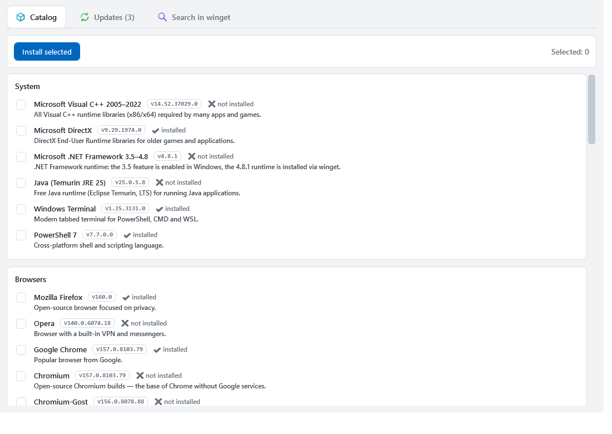
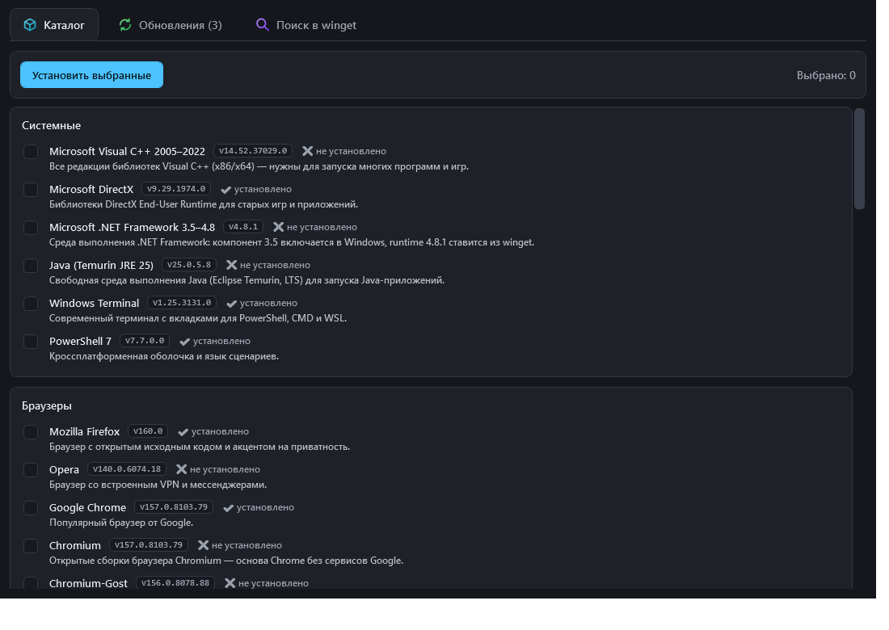
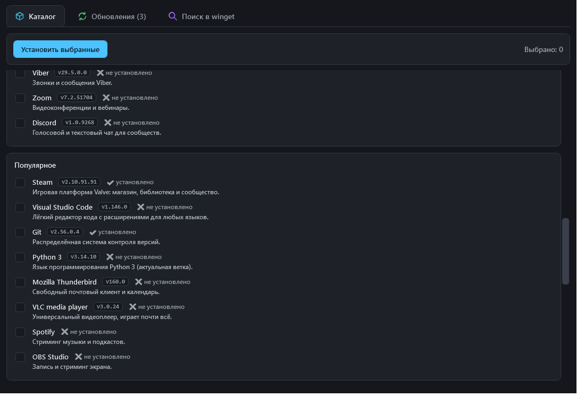
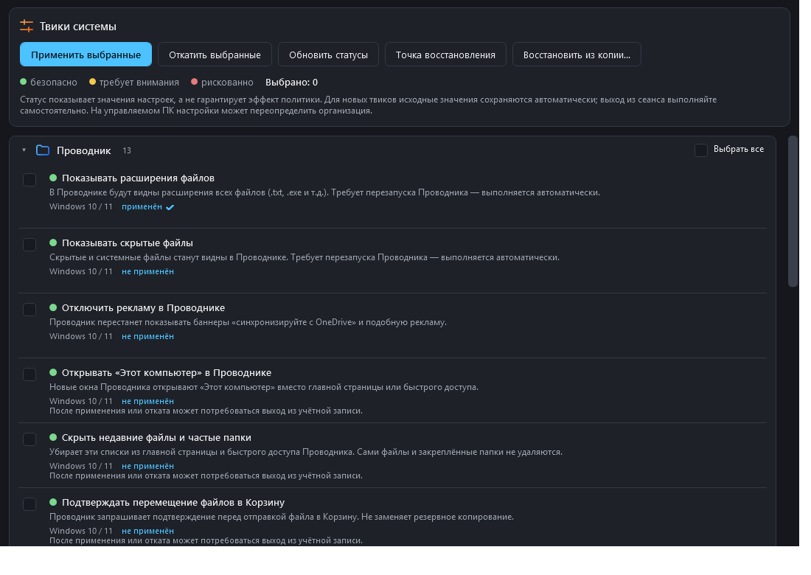

<div align="center">


# Windows Post-Install Client (WPIC)

**One tool to bring a freshly installed Windows 10/11 back to life — even with no network at all.**

[](https://github.com/denvisss/WPIC/releases/latest)
[](https://github.com/denvisss/WPIC/releases)
[](#-building-from-source)
[](#-requirements)
[](#-verification)
[](#)

**English** · [Русский](#-русский)

</div>

---

## 📖 About

WPIC is a WPF desktop utility for the first minutes after a clean Windows install. It detects network adapters that have no driver, installs the newest matching LAN/Wi-Fi driver from an embedded offline pack, bootstraps **winget offline** from signed Microsoft packages, then batch-installs applications and applies system tweaks — with a full undo path.

- 🖧 **Offline drivers** — auto-detects driverless NIC/Wi-Fi adapters, matches hardware IDs against a curated pack, installs only the newest version per device (Windows 10/11, x64).
- 📦 **Offline winget** — signed `AppInstaller` / `VCLibs` / `UI.Xaml` bundles embedded in the executable; no internet needed to get winget itself.
- 🗂 **App catalog** — 49 apps in 7 sections with RU/EN descriptions and live version badges refreshed from winget at every startup; multi-select + batch install.
- 🔍 **winget search** — search the whole winget repository and install anything from it.
- 🛠 **20 system tweaks** — grouped by category, risk-marked, snapshotted before apply, one-click undo.
- 🌐 **Bilingual UI** — English / Russian, dark / light themes.
- 📜 **Live log** — every operation streamed to an on-screen log and to disk.

## 🖼 Screenshots

| App catalog (dark, EN) | Catalog, light theme |
|---|---|
|  |  |

## 📥 Releases

Version **0.2.0** ships four artifacts; every file has a `.sha256` sidecar next to it. Download from [GitHub Releases](https://github.com/denvisss/WPIC/releases/latest).

| File | Size | What it is |
|---|---|---|
| `WPIC_0.2.0-full.exe` | ≈ 436 MiB | Inno Setup installer: app + .NET runtime + embedded LAN/Wi-Fi driver pack + offline winget payload |
| `WPIC_0.2.0-full.zip` | ≈ 436 MiB | The same installer inside a zip (convenient for mirrors / download managers) |
| `WPIC_0.2.0-portable.exe` | ≈ 134 MiB | Single-file portable app, no installation: embedded winget payload, **no** embedded drivers |
| `WPIC_0.2.0-portable.zip` | ≈ 127 MiB | The same portable exe inside a zip |

The `.zip` variants contain exactly the same executable as the matching `.exe` — pick whichever your download channel prefers. Verify with `Get-FileHash` (PowerShell) or `sha256sum` against the sidecar file.

### 🆚 Full vs Portable

| Capability | Full | Portable |
|---|:---:|:---:|
| Runs without installing anything | ✗ (Inno Setup wizard) | ✓ single exe |
| Requires administrator (UAC at start) | ✓ | ✓ |
| Requires a preinstalled .NET runtime | ✗ self-contained | ✗ self-contained |
| Offline winget bootstrap | ✓ | ✓ (payload unpacks to `%LOCALAPPDATA%\WPIC\winget` on first use) |
| Embedded LAN/Wi-Fi driver pack | ✓ newest-only, Win 10/11 x64 | ✗ bring your own pack |
| External driver packs (folder / drag & drop / auto-search) | ✓ | ✓ |
| App catalog, winget search, tweaks, RU/EN, themes | ✓ | ✓ |
| Editable `configs\*.json` next to the exe | ✓ | ✓ (embedded copy used when absent) |

**Choose full** for a clean machine with no network: install, open the *Drivers* tab, press one button. **Choose portable** for a USB stick / service toolkit: carry it together with any driver pack you trust.

### ⚖️ Why are the files so large?

Almost everything inside is **already-compressed, signed or curated binary content** that cannot be shrunk further:

| Component | Size | Full | Portable |
|---|---|:---:|:---:|
| Curated LAN/Wi-Fi driver pack (`WPIC-Drivers.7z`, newest version per device) | ≈ 243 MiB | ✓ | ✗ |
| Driver hardware-ID index (`index.tsv`, text — compresses well) | ≈ 19 MiB | ✓ | ✗ |
| Signed Microsoft winget payload (`AppInstaller`, `VCLibs`, `UI.Xaml` msix/appx) | ≈ 69 MiB | ✓ | ✓ embedded |
| Self-contained .NET 8 + WPF runtime and the app itself | ≈ 65 MiB | ✓ | ✓ |
| Bundled 7-Zip (`7za64.exe`, used for pack extraction) | ≈ 1.2 MiB | ✓ | ✓ |

A `.7z` driver archive and Microsoft's msix/appx bundles are compressed containers by design — recompressing them gains nothing, so the installer size is essentially the **sum of its payloads**. Inno Setup's LZMA2 only shrinks the compressible parts (runtime files, text index). The portable exe drops the 262 MiB driver pack, which is exactly why it is ~300 MiB smaller. The zip variants use fast compression for the same reason: the exe inside is already compressed.

## 💻 Requirements

- Windows 10 (1809+) or Windows 11, **x64**.
- Administrator rights — UAC is requested automatically at startup.
- No .NET installation needed (runtime is embedded).
- Internet is optional: needed only for installing apps from winget and refreshing catalog version badges. Drivers and winget itself work fully offline.

## 🖧 Driver packs (portable, or extra packs in full)

The *Drivers* tab auto-detects adapterless NIC/Wi-Fi devices on open and offers **Match & install**. Without an embedded pack (portable) it asks for a pack folder; two formats are accepted:

- **External pack** (e.g. downloaded from [driveroff.net](https://driveroff.net/sam/)): a folder with `Drivers\*.7z` and `Index\DIA\*.txt` — WPIC builds its own index and keeps the newest versions;
- **WPIC-format pack**: a folder with `index.tsv` + `WPIC-Drivers.7z` (can be copied from an installed full version).

You can also **drag & drop** a pack folder (or any file inside it) onto the window — the *Drivers* tab opens and loads it. Packs are auto-searched next to the exe, in every local drive root and on removable media. Licensing of third-party drivers remains your responsibility.

## 🗂 App catalog & winget

Seven sections: **System** (VC++ 2005–2022 bundle, DirectX, .NET Framework 3.5 + 4.8.1, Java, Windows Terminal, PowerShell), **Browsers** (Firefox, Opera, Chrome, Chromium, Chromium-Gost, Yandex Browser, Tor), **Utilities** (7-Zip, WinRAR, PowerToys, Everything, qBittorrent, Notepad++, SumatraPDF), **Communication** (Telegram, WhatsApp, Viber, Zoom, Discord), **Popular** (Steam, VS Code, Git, Python, Thunderbird, VLC, Spotify, OBS), plus **Media** and **Players**.

- Every entry carries a short description in the UI language and a version badge.
- Versions are checked against winget **at every startup** (parallel exact-id lookups); the previous result is cached in `%LOCALAPPDATA%\WPIC\catalog-versions.json` and shown instantly while the refresh runs. Store-only packages show an `MS Store` badge.
- Tick any number of apps and press **Install selected**. Multi-package entries (VC++ = 12 redistributables) skip parts that are already installed; `.NET Framework 3.5` is enabled through DISM (`NetFx3`), 4.8.1 comes from winget.
- The *winget search* sub-tab installs anything else from the repository; a banner offers the offline winget bootstrap when winget is missing.

## 🛠 System tweaks

20 tweaks in four categories (Explorer; taskbar & Start; privacy; system), filterable by chips. Each row shows a risk dot and a live status; unavailable tweaks (build/edition limits) cannot be selected.

Before applying, registry values and system parameters are snapshotted to `%LOCALAPPDATA%\WPIC\backup\<date>\registry-backup.json`; a failed backup aborts the apply. Undo restores the pre-first-apply originals from `%LOCALAPPDATA%\WPIC\tweak-originals.json` (survives re-apply and restarts). Defaults are never guessed when no original exists; `command`-type tweaks are not reverted by restore.

## ⚙️ Customization (no rebuild needed)

**Apps** — edit `configs/apps.json` next to the exe (embedded copy is used when the file is absent, e.g. portable):

```json
{
  "id": "steam",
  "name": "Steam",
  "wingetId": "Valve.Steam",
  "description": "Клиент игр",
  "descriptionEn": "Game client",
  "wingetIds": ["Optional.MultiPackage", "Optional.SecondId"],
  "windowsFeature": "NetFx3"
}
```

`wingetIds` lists all packages of a multi-package entry; `windowsFeature` enables a Windows component via DISM after install. Find ids with `winget search "name"`.

**Tweaks** — edit `configs/tweaks.json` (`category`: `explorer`, `start`, `privacy`, `system`). Three action types:

- `registry` — writes a registry value; missing keys are created, the original value and its real type are saved automatically;
- `systemParameter` — `animations`, `stickyKeysHotkey` or `filterKeysHotkey` via the Windows API;
- `command` — cmd command with `undoCommand`; non-zero exit codes count as errors, original state is not captured.

`minBuild`/`maxBuild` restrict Windows builds, `editions` restricts editions, `signOutRequired` shows a sign-out hint.

## 🔨 Building from source

Requires .NET 8 SDK, Windows and Inno Setup 6.3+ (path override: `build-release.ps1 -Iscc`). The winget payload is embedded at compile time, so fetch it **before the first build and before `dotnet test`** (internet needed once):

```powershell
New-Item -ItemType Directory -Force build\payload\DriverPack | Out-Null
Copy-Item src\WPIC\Tools\7za64.exe build\payload\DriverPack\
.\build\fetch-winget.ps1
dotnet test tests\WPIC.Tests\WPIC.Tests.csproj
.\build\build-release.ps1
```

The script verifies Microsoft package signatures, runs Release tests and produces all four artifacts plus `.sha256` sidecars in `build\release\`. CI (`.github/workflows/ci.yml`) fetches the winget payload and runs `dotnet test` on Windows for every push and PR.

### Refreshing the driver pack (only when the pack changes)

Place the source pack folder (`Drivers_26.8_LAN` with `Drivers` and `Index`) in the project root, then:

```powershell
$packs = 'DP_LAN_Intel_26081', 'DP_LAN_Others_26081', 'DP_LAN_Realtek-NT_26081', 'DP_WLAN-WiFi_26082'
foreach ($pack in $packs) {
    .\build\curate-drivers.ps1 -Mode index -Pack $pack
    .\build\curate-drivers.ps1 -Mode extract -Pack $pack
}
.\build\curate-drivers.ps1 -Mode finalize
Copy-Item build\curated\payload\DriverPack\* build\payload\DriverPack\ -Force
.\build\prune-drivers.ps1          # newest versions + folder dedupe + repack
Copy-Item build\prune\index.tsv build\payload\DriverPack\index.tsv -Force
Copy-Item build\prune\payload\DriverPack\WPIC-Drivers.7z build\payload\DriverPack\WPIC-Drivers.7z -Force
.\build\fetch-winget.ps1           # signed winget packages (once, internet needed)
```

`curate-drivers.ps1` needs a fresh working directory (`-Work`) on re-runs. `prune-drivers.ps1 -KeepVersions 2` restores the older "newest + previous" behaviour.

## 📁 Data locations

| Data | Path |
|---|---|
| Logs | `%LOCALAPPDATA%\WPIC\logs\` (header button opens the folder) |
| Registry backups | `%LOCALAPPDATA%\WPIC\backup\` |
| Tweak state / originals | `%LOCALAPPDATA%\WPIC\state.json`, `tweak-originals.json` |
| Driver extraction cache / bundled 7-Zip | `%LOCALAPPDATA%\WPIC\driver-cache\`, `%LOCALAPPDATA%\WPIC\tools\` |
| Unpacked winget payload (portable) | `%LOCALAPPDATA%\WPIC\winget\` |
| Catalog version cache | `%LOCALAPPDATA%\WPIC\catalog-versions.json` |

## ✅ Verification

126 xUnit tests (catalog contract, winget table parsing, tweak engine, driver index, localization) plus offscreen WPF UI harnesses that exercise the real views: catalog rendering/selection/batch button, tweak apply/undo against an isolated registry key, winget banner states and pack drag & drop.

## 📜 Licenses

Project code is at the author's discretion. The app redistributes `7za64.exe` (7-Zip, LGPL — see 7-zip.org) and unmodified signed Microsoft packages (winget, UI.Xaml, VCLibs). Third-party drivers enter the repository and the full installer only after their licenses have been checked independently.

## ⚠️ Limitations

- The Inno Setup wizard flow and driver/winget installation on a truly clean, network-less Windows are not covered by automated tests — verify manually before publishing a release.
- Tweak statuses reflect setting values; organization policies may override their effect.

---

<div align="center">

## 🇷🇺 Русский

[English](#windows-post-install-client-wpic) · **Русский**

</div>

## 📖 О программе

WPIC — утилита (WPF, .NET 8) для первых минут после чистой установки Windows 10/11: находит сетевые карты без драйвера, ставит новейший драйвер LAN/Wi-Fi из встроенного офлайн-пака, поднимает **winget без интернета** из подписанных пакетов Microsoft, затем пакетно устанавливает приложения и применяет твики системы с полным откатом.

- 🖧 **Офлайн-драйверы** — автоопределение NIC/Wi-Fi без драйвера, подбор по ID оборудования, только новейшая версия на устройство (Win 10/11, x64).
- 📦 **Офлайн-winget** — подписанные `AppInstaller` / `VCLibs` / `UI.Xaml` встроены в exe.
- 🗂 **Каталог** — 49 приложений в 7 разделах, описания RU/EN и бейджи версий, обновляемые из winget при каждом запуске; выбор галочками и пакетная установка.
- 🔍 **Поиск в winget** — установка любых пакетов репозитория.
- 🛠 **20 твиков** — категории, отметки риска, снимок значений до применения, откат одной кнопкой.
- 🌐 **Интерфейс** — русский/английский, тёмная/светлая темы.
- 📜 **Журнал** — все операции в экране и на диске.

## 🖼 Скриншоты

| Каталог (тёмная тема) | Раздел «Популярное» |
|---|---|
|  |  |

| Вкладка «Драйверы»: автоопределение | Твики: категории и статусы |
|---|---|
|  |  |

## 📥 Выпуски

Версия **0.2.0**, четыре артефакта, у каждого файл `.sha256`. Скачивание: [GitHub Releases](https://github.com/denvisss/WPIC/releases/latest).

| Файл | Размер | Содержимое |
|---|---|---|
| `WPIC_0.2.0-full.exe` | ≈ 436 МиБ | Установщик Inno Setup: приложение + .NET + встроенный пак драйверов LAN/Wi-Fi + офлайн-пакеты winget |
| `WPIC_0.2.0-full.zip` | ≈ 436 МиБ | Тот же установщик в zip |
| `WPIC_0.2.0-portable.exe` | ≈ 134 МиБ | Портативный exe без установки: встроенный winget-пак, **без** встроенных драйверов |
| `WPIC_0.2.0-portable.zip` | ≈ 127 МиБ | Тот же portable exe в zip |

Zip-варианты содержат тот же exe, что и одноимённый `.exe`. Проверка: `Get-FileHash` или `sha256sum` против файла `.sha256`.

### 🆚 Full и Portable

| Возможность | Full | Portable |
|---|:---:|:---:|
| Запуск без установки | ✗ (мастер Inno Setup) | ✓ один exe |
| Права администратора (UAC при старте) | ✓ | ✓ |
| Нужен установленный .NET | ✗ встроен | ✗ встроен |
| Офлайн-установка winget | ✓ | ✓ (пак распаковывается в `%LOCALAPPDATA%\WPIC\winget` при первом обращении) |
| Встроенный пак драйверов LAN/Wi-Fi | ✓ новейшие, Win 10/11 x64 | ✗ пак указывается вручную |
| Внешние паки (папка / drag & drop / автопоиск) | ✓ | ✓ |
| Каталог, поиск winget, твики, RU/EN, темы | ✓ | ✓ |
| Правка `configs\*.json` рядом с exe | ✓ | ✓ (при отсутствии файла — встроенная копия) |

**Full** — для чистой машины без сети: установил, открыл «Драйверы», нажал одну кнопку. **Portable** — для флешки/сервисного набора: носите вместе с любым паком драйверов, которому доверяете.

### ⚖️ Почему установщики столько весят

Почти всё содержимое — **уже сжатые или подписанные бинарные контейнеры**, которые нельзя ужать повторно:

| Компонент | Размер | Full | Portable |
|---|---|:---:|:---:|
| Пак драйверов LAN/Wi-Fi (`WPIC-Drivers.7z`, новейшая версия на устройство) | ≈ 243 МиБ | ✓ | ✗ |
| Индекс ID оборудования (`index.tsv`, текст — хорошо жмётся) | ≈ 19 МиБ | ✓ | ✗ |
| Подписанные пакеты winget (`AppInstaller`, `VCLibs`, `UI.Xaml`) | ≈ 69 МиБ | ✓ | ✓ встроены |
| Автономный runtime .NET 8 + WPF и само приложение | ≈ 65 МиБ | ✓ | ✓ |
| Встроенный 7-Zip (`7za64.exe`) | ≈ 1,2 МиБ | ✓ | ✓ |

Архив `.7z` и msix/appx-пакеты Microsoft сжаты по своей природе — повторное сжатие ничего не даёт, поэтому размер установщика ≈ **сумма его payload'ов**; LZMA2 Inno Setup ужимает только сжимаемую часть (runtime, текстовый индекс). Portable не несёт пак драйверов (262 МиБ) — отсюда разница ≈ 300 МиБ. Zip-варианты жмутся быстро по той же причине: exe внутри уже сжат.

## 💻 Требования

- Windows 10 (1809+) / 11, **x64**; права администратора (UAC автоматически).
- .NET ставить не нужно; интернет нужен только для установки приложений из winget и обновления бейджей версий. Драйверы и сам winget работают полностью офлайн.

## 🖧 Паки драйверов (portable и дополнительные паки в full)

Вкладка «Драйверы» при открытии сама находит NIC/Wi-Fi без драйвера и предлагает «Подобрать и установить». Без встроенного пака (portable) просит указать папку; принимаются два формата:

- **внешний пак** (например, с [driveroff.net](https://driveroff.net/sam/)): папка с `Drivers\*.7z` и `Index\DIA\*.txt` — приложение строит индекс и оставляет новейшие версии;
- **пак формата WPIC**: папка с `index.tsv` и `WPIC-Drivers.7z` (можно скопировать из установленной full-версии).

Пак можно **перетащить мышью** на окно (папку или файл внутри неё) — вкладка «Драйверы» откроется сама. Автопоиск: рядом с exe, в корне каждого локального диска и на съёмных носителях. Ответственность за лицензии сторонних драйверов — на пользователе.

## 🗂 Каталог и winget

Семь разделов: **Системные** (VC++ 2005–2022, DirectX, .NET Framework 3.5 + 4.8.1, Java, Windows Terminal, PowerShell), **Браузеры** (Firefox, Opera, Chrome, Chromium, Chromium-Gost, Яндекс Браузер, Tor), **Утилиты** (7-Zip, WinRAR, PowerToys, Everything, qBittorrent, Notepad++, SumatraPDF), **Общение** (Telegram, WhatsApp, Viber, Zoom, Discord), **Популярное** (Steam, VS Code, Git, Python, Thunderbird, VLC, Spotify, OBS), а также **Медиа** и **Плееры**.

- У каждой записи — короткое описание на языке интерфейса и бейдж версии.
- Версии сверяются с winget **при каждом запуске** (параллельные точные запросы по id); прошлый результат кэшируется в `%LOCALAPPDATA%\WPIC\catalog-versions.json` и показывается мгновенно, пока идёт обновление. Пакеты только из Store получают бейдж `MS Store`.
- Отметьте галочками любое число приложений и нажмите «Установить выбранное». Многопакетные записи (VC++ = 12 редактаций) пропускают уже установленное; .NET Framework 3.5 включается через DISM (`NetFx3`), 4.8.1 ставится из winget.
- Подвкладка «Поиск в winget» ставит любые пакеты репозитория; при отсутствии winget баннер предлагает офлайн-установку.

## 🛠 Твики системы

20 твиков в четырёх категориях (Проводник; панель задач и меню Пуск; приватность; система), чипы-фильтры над списком. У каждой строки — точка риска и живой статус; недоступные твики (ограничения сборки/редакции) выбрать нельзя.

Перед применением значения реестра и системных параметров сохраняются в `%LOCALAPPDATA%\WPIC\backup\<дата>\registry-backup.json`; ошибка копирования останавливает применение. Откат берёт исходные значения до первого применения из `%LOCALAPPDATA%\WPIC\tweak-originals.json` (переживает повторное применение и перезапуск). При отсутствии исходной копии значения по умолчанию не подставляются; восстановление не отменяет `command`-твики.

## ⚙️ Настройка без пересборки

**Приложения** — `configs/apps.json` рядом с exe (при отсутствии файла используется встроенная копия):

```json
{
  "id": "steam",
  "name": "Steam",
  "wingetId": "Valve.Steam",
  "description": "Клиент игр",
  "descriptionEn": "Game client",
  "wingetIds": ["Optional.MultiPackage", "Optional.SecondId"],
  "windowsFeature": "NetFx3"
}
```

`wingetIds` — все пакеты многопакетной записи; `windowsFeature` — компонент Windows, включаемый через DISM после установки. Id ищется командой `winget search "имя"`.

**Твики** — `configs/tweaks.json` (`category`: `explorer`, `start`, `privacy`, `system`). Три вида действий:

- `registry` — запись значения в реестр; отсутствующий ключ создаётся, исходное значение и его фактический тип сохраняются автоматически;
- `systemParameter` — `animations`, `stickyKeysHotkey` или `filterKeysHotkey` через API Windows;
- `command` — команда cmd с `undoCommand`; ненулевой код завершения считается ошибкой, исходное состояние не сохраняется.

`minBuild`/`maxBuild` ограничивают сборки, `editions` — редакции, `signOutRequired` показывает подсказку о выходе из сеанса.

## 🔨 Сборка

Нужны .NET 8 SDK, Windows и Inno Setup 6.3+ (путь: `build-release.ps1 -Iscc`). Winget-пак встраивается на этапе компиляции, поэтому скачайте его **до первой сборки и до `dotnet test`** (интернет нужен один раз):

```powershell
New-Item -ItemType Directory -Force build\payload\DriverPack | Out-Null
Copy-Item src\WPIC\Tools\7za64.exe build\payload\DriverPack\
.\build\fetch-winget.ps1
dotnet test tests\WPIC.Tests\WPIC.Tests.csproj
.\build\build-release.ps1
```

Скрипт проверяет подписи Microsoft-пакетов, прогоняет Release-тесты и создаёт в `build\release\` все четыре артефакта с `.sha256`. CI (`.github/workflows/ci.yml`) сам скачивает winget-пак и гоняет `dotnet test` на Windows для каждого push и PR.

### Обновление набора драйверов (только при смене пака)

Исходный пак (папка `Drivers_26.8_LAN` с `Drivers` и `Index`) кладётся в корень проекта, затем:

```powershell
$packs = 'DP_LAN_Intel_26081', 'DP_LAN_Others_26081', 'DP_LAN_Realtek-NT_26081', 'DP_WLAN-WiFi_26082'
foreach ($pack in $packs) {
    .\build\curate-drivers.ps1 -Mode index -Pack $pack
    .\build\curate-drivers.ps1 -Mode extract -Pack $pack
}
.\build\curate-drivers.ps1 -Mode finalize
Copy-Item build\curated\payload\DriverPack\* build\payload\DriverPack\ -Force
.\build\prune-drivers.ps1          # новейшие версии + дедупликация папок + перепаковка
Copy-Item build\prune\index.tsv build\payload\DriverPack\index.tsv -Force
Copy-Item build\prune\payload\DriverPack\WPIC-Drivers.7z build\payload\DriverPack\WPIC-Drivers.7z -Force
.\build\fetch-winget.ps1           # подписанные пакеты winget (один раз, нужен интернет)
```

`curate-drivers.ps1` требует свежий рабочий каталог (`-Work`) при повторном запуске. `prune-drivers.ps1 -KeepVersions 2` возвращает поведение «новейшая + предыдущая».

## 📁 Данные приложения

| Данные | Путь |
|---|---|
| Журналы | `%LOCALAPPDATA%\WPIC\logs\` (кнопка в заголовке панели «Журнал») |
| Резервные копии реестра | `%LOCALAPPDATA%\WPIC\backup\` |
| Состояние / исходные значения твиков | `%LOCALAPPDATA%\WPIC\state.json`, `tweak-originals.json` |
| Кэш драйверов / встроенный 7-Zip | `%LOCALAPPDATA%\WPIC\driver-cache\`, `%LOCALAPPDATA%\WPIC\tools\` |
| Распакованный winget-пак (portable) | `%LOCALAPPDATA%\WPIC\winget\` |
| Кэш версий каталога | `%LOCALAPPDATA%\WPIC\catalog-versions.json` |

## ✅ Проверка

126 тестов xUnit (контракт каталога, парсинг таблиц winget, движок твиков, индекс драйверов, локализация) плюс офскрин-харнесы WPF на реальных вкладках: рендеринг/выбор/пакетная кнопка каталога, применение и откат твиков на изолированном ключе реестра, состояния баннера winget и drag & drop пака.

## 📜 Лицензии

Код проекта — на усмотрение автора. В составе приложения распространяются `7za64.exe` (7-Zip, LGPL — см. 7-zip.org) и неизменённые подписанные пакеты Microsoft (winget, UI.Xaml, VCLibs). Сторонние драйверы попадают в репозиторий и full-установщик только после самостоятельной проверки их лицензий.

## ⚠️ Ограничения

- Мастер Inno Setup и установка драйверов/winget на чистой Windows без сети не покрыты автотестами — перед публикацией релиза проверьте вручную.
- Статусы твиков отражают значения настроек; политики организации могут переопределять эффект.